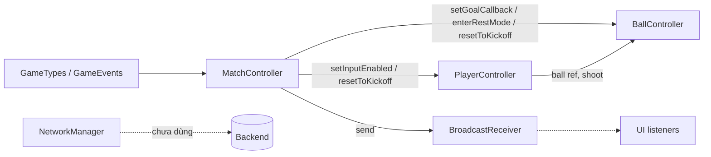
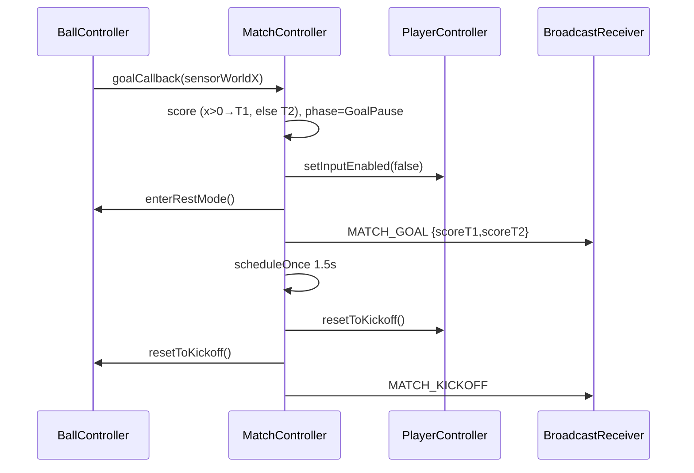

# Architecture

## Overview

## Flows

**Match flow (F005)**: Menu Play / Rematch → `MATCH_START` → MatchController.startMatch (MatchData.reset, SlowMo.reset, resetPositions) → Countdown (`MATCH_COUNTDOWN{n}`, input khóa, ~0.9s) → `MATCH_KICKOFF` → Playing (30s thực/hiệp, `MATCH_TIME{display}`, energy +1.5/s) → hết hiệp 1: `MATCH_HALFTIME` (khóa input) → HalfTimePopup Continue → `MATCH_START_HALF2` → Countdown → hiệp 2 → hòa: `MATCH_OVERTIME` (golden goal, timer dừng) → bàn thắng/hết hiệp 2 → FullTime: `MATCH_END` + `MATCH_RESULT{score1,score2}` → ResultPopup (Rematch → MATCH_START, Menu → MenuPopup).

| Event | Sender → Listener |
|---|---|
| MATCH_START | MenuPopup/ResultPopup → MatchController, AiController(stop), HudMatch, AudioManager |
| MATCH_START_HALF2 | HalfTimePopup → MatchController |
| MATCH_COUNTDOWN / MATCH_TIME | MatchController → HudMatch, AudioManager |
| MATCH_KICKOFF | MatchController → AiController (chọn strategy), SuperAbility (cancel), AudioManager |
| MATCH_GOAL / HALFTIME / OVERTIME | MatchController → HudMatch, AudioManager (HALFTIME → HalfTimePopup) |
| MATCH_END / MATCH_RESULT | MatchController → HudMatch, AiController, SuperAbility, AudioManager / ResultPopup |
| ENERGY_CHANGED / SUPER_USED | MatchController, SuperAbility → HudMatch / AudioManager |
| BALL_SHOT / BALL_BOUNCE | BallController → AudioManager |
| PLAYER_TACKLE / PLAYER_STUN | PlayerController → AudioManager |

Human = score1 = T_1 = side +1; Bot = score2 = T_2 = side -1 (`PlayerController.side` là @property, bot phải set -1 trong Editor). SlowMo (static) scale physics qua fixedTimeStep; MatchController reset ở goal/half end/kickoff/start/disable.

## Data
| Type | Giá trị |
|---|---|
| MatchPhase | Idle, Countdown, Playing, GoalPause, HalfTime, Overtime, FullTime |
| GameState | IDLE, PLAYING, PAUSED, RESULT |
| IState (player) | Idle, Run, Jump, Tackle, Stun |
| Side | Human=1, Bot=-1 |
| GAME_EVENTS | xem bảng event ở Flows (paddle-hit = legacy) |

## External
- NetworkManager: query param `url_api` → httpBaseUrl; WS wsHost/wsPort (default localhost:3000). Chưa có caller trong game.

## Scene
`Game.scene` (nguồn: MCP get_hierarchy). Canvas world (427,240); tâm sân local x=0.
- Managers [PhysicsDebug2D] (chưa có MatchController — cần gắn)
- Canvas [Canvas, Widget]
  - Camera, BG
  - WorldRoot
    - FieldPhysics: GroundCollider, Wall_1 (x-365), Wall_2 (x365), GoalSensorLeft (local x=+325!), GoalSensorRight (local x=-325!) — tên ngược vị trí; code dựa vào sensorX > centerX → T_1
    - Actors: Player [RigidBody2D, 3×BoxCollider2D, PlayerController] (1 child), Ball [Sprite, RigidBody2D, BoxCollider2D, BallController]
    - PlayGround: GoalLeft (x-365), GoalRight (x365, scaleX -1) [Sprite]
    - Effects (rỗng)
  - UIRoot: ScoreBar{Bar, T_1, T_2 [Label], Icon_1, Icon_2}, TimeLabel [Label], help0000/help0001 [Sprite]
  - PopupRoot (rỗng)
