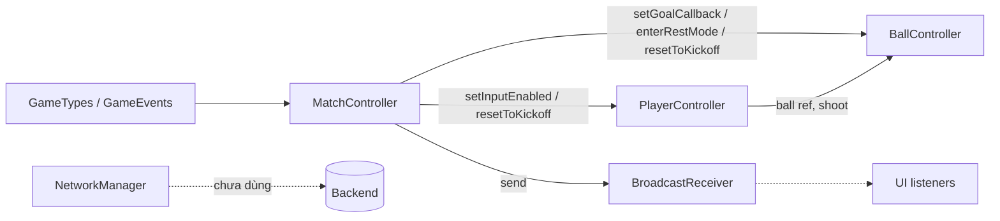
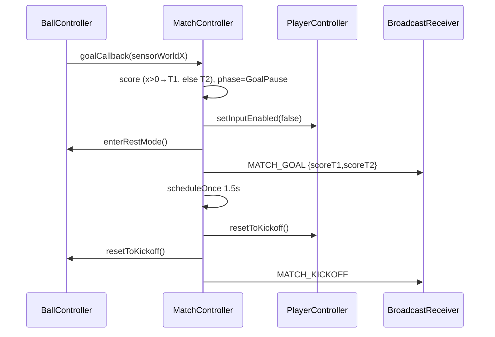

# Architecture

## Overview

## Flows

Hết giờ: update() cộng dt tới MATCH_DURATION=90 → enterFullTime → MATCH_END {phase}.

## Data
| Type | Giá trị |
|---|---|
| MatchPhase | Playing, GoalPause, FullTime |
| GameState | IDLE, PLAYING, PAUSED, RESULT |
| IState (player) | Idle, Run, Jump, Tackle, Stun |
| Side | Human=1, Bot=-1 |
| GAME_EVENTS | paddle-hit(?legacy), MATCH_GOAL, MATCH_END, MATCH_KICKOFF |

## External
- NetworkManager: query param `url_api` → httpBaseUrl; WS wsHost/wsPort (default localhost:3000). Chưa có caller trong game.
